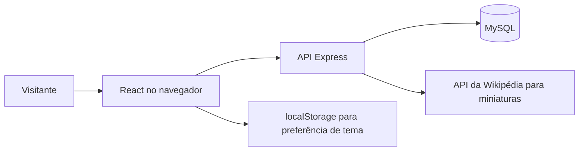

# HeroBoxd

<div align="center">
  
  <p><strong>HeroBoxd</strong></p>
  <p>Um catálogo social para descobrir, avaliar e organizar histórias de super-heróis.</p>
  <p><strong>React · Node.js · Express · MySQL</strong></p>
</div>

HeroBoxd é um projeto de portfólio que reúne filmes, séries, jogos e quadrinhos em uma experiência de catálogo com contas, avaliações públicas e listas pessoais.

## O que você pode fazer

- Explorar 80 títulos, pesquisar e filtrar por formato e editora.
- Abrir os detalhes de cada mídia, avaliar de 1 a 5 estrelas e escrever uma resenha.
- Organizar uma estante pessoal com “Quero ver”, “Já vi/li” e “Favoritos”.
- Alternar o tema visual e usar a interface responsiva em celular ou desktop.
- Criar uma conta com nome, e-mail e idade. A sessão começa após o cadastro.
- Solicitar a exclusão da conta, avaliações e listas associadas.
- Recuperar o acesso com um link enviado ao e-mail cadastrado (após configurar o provedor).

## Como foi construído

| Camada | Implementação |
| --- | --- |
| Interface | React 18 servido diretamente pelo Express, CSS responsivo e PWA básica |
| API | Node.js 24 LTS e Express 5 com rotas para catálogo, contas, avaliações e listas |
| Persistência | MySQL 8 com consultas parametrizadas e chaves estrangeiras |
| Autenticação | Senha derivada com `scrypt`; sessão aleatória armazenada como hash e cookie HttpOnly |
| Recuperação de acesso | Token aleatório de uso único, armazenado como hash e enviado via Resend |
| Catálogo | 80 registros editoriais sincronizados pelo comando `npm run seed` |



Veja os componentes, rotas e relações de dados em [docs/architecture.md](docs/architecture.md). As instruções de execução limpa e publicação estão em [docs/development-and-deployment.md](docs/development-and-deployment.md).

## Executar localmente

Requisitos: Node.js 24 LTS e MySQL 8.4+. Na raiz do repositório:

```powershell
npm ci
Copy-Item .env.example .env
```

Configure o acesso ao MySQL no `.env`. Com o cliente MySQL disponível no terminal, crie as tabelas e preencha o catálogo:

```powershell
mysql -u root -p
```

No prompt do MySQL, importe o esquema:

```sql
source backend/schema.sql
```

De volta ao terminal do projeto:

```powershell
npm run seed
npm start
```

Abra `http://127.0.0.1:4175` (ou a porta definida por `PORT`). Para a configuração local do Windows já preparada neste computador, consulte [docs/development-and-deployment.md](docs/development-and-deployment.md#atalho-local-do-windows).

## Dados e privacidade

As avaliações são públicas dentro do mesmo site e do mesmo banco de dados. O nome escolhido aparece nas resenhas; e-mail e idade não são retornados pela API pública. Na execução local, os dados ficam apenas no banco desta máquina. Para compartilhar opiniões entre dispositivos, publique a aplicação ligada a um MySQL remoto persistente e compartilhado.

Leia a [política de privacidade](frontend/public/privacidade.html). Antes de receber usuários em produção, preencha nela os dados de contato de quem opera a instalação e confirme que os prazos descritos correspondem à hospedagem e aos backups utilizados.

## Estado do projeto

- O servidor e o fluxo de cadastro, avaliação e leitura pública foram verificados localmente.
- Não há bundler: o Express serve diretamente os arquivos React e CSS. `npm test` executa os testes automatizados e `npm run check` verifica a sintaxe; ambos também rodam no GitHub Actions.
- Login e cadastro têm limite básico de tentativas em memória por processo. Em produção com múltiplas instâncias, configure limite compartilhado no proxy ou substitua-o por armazenamento compartilhado.
- A recuperação de senha por e-mail está implementada; configure `RESEND_API_KEY`, um `MAIL_FROM` verificado e `PUBLIC_BASE_URL` para enviar mensagens.
- Uma imagem Docker de produção está disponível para hosts de contêiner.
- As miniaturas automáticas agora pedem imagens marcadas como livres pela Wikimedia. A licença pode variar por arquivo; verifique atribuição e termos antes de republicar imagens ou marcas.

## Estrutura do repositório

```text
backend/
  migrations/        migrações para bancos existentes
  catalog.js         sincronização do catálogo de demonstração
  reset-local-password.js
  schema.sql         estrutura do banco para instalações novas
  server.js          API e servidor de arquivos
frontend/
  public/            HTML, marca, manifesto e service worker
  src/               interface React e estilos
docs/                arquitetura e instruções de execução/publicação
```

## Recuperar uma conta local

Se o e-mail já estiver cadastrado, use **Entrar**. Caso a senha não seja aceita nesta instalação local, rode `npm run reset:local-password` no terminal da raiz. A ferramenta pede uma nova senha sem exibi-la e invalida sessões antigas. Ela recusa conexões MySQL remotas; recuperação em produção precisa ser feita por um fluxo verificado por e-mail.

Para habilitar “Esqueci minha senha” em um site publicado, configure `RESEND_API_KEY`, `MAIL_FROM` com remetente validado e `PUBLIC_BASE_URL` com o endereço HTTPS público. Execute a migração `backend/migrations/002_add_password_reset_tokens.sql` nos bancos existentes. Os links expiram em uma hora e funcionam uma única vez; redefinir a senha encerra as sessões ativas.

## Licença

O código original deste repositório está sob a licença MIT, em [LICENSE](LICENSE). Essa licença não cobre marcas, personagens, pôsteres ou outros materiais de terceiros incluídos ou referenciados. O projeto é independente e não possui afiliação oficial com Marvel, DC ou outros detentores de marcas e personagens.
