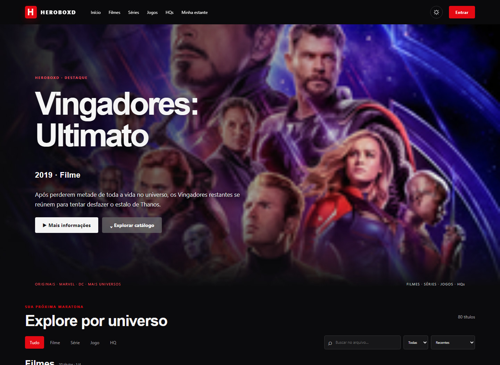
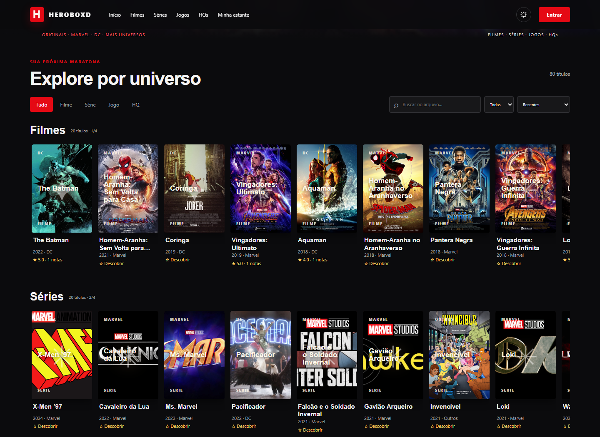
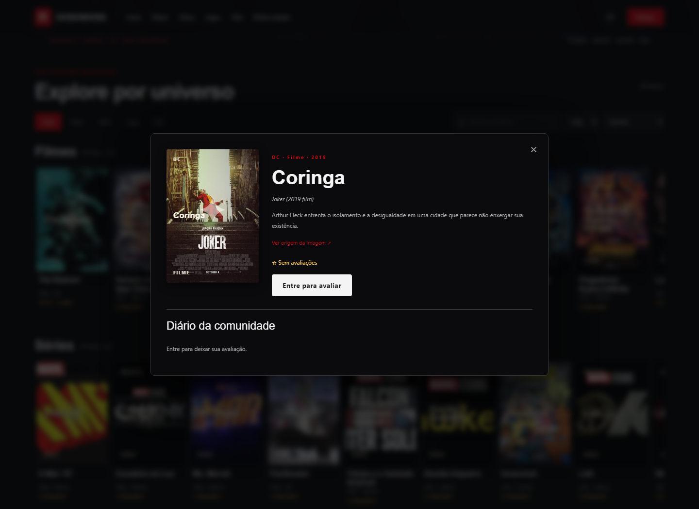
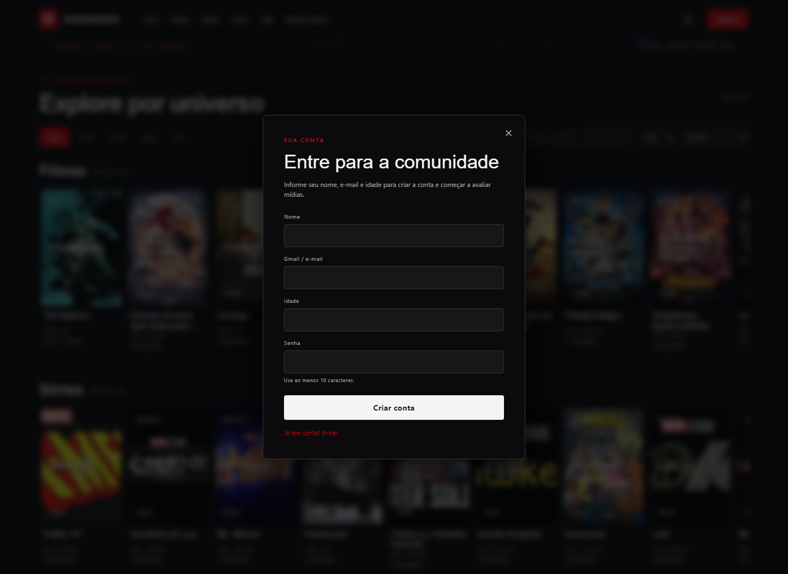
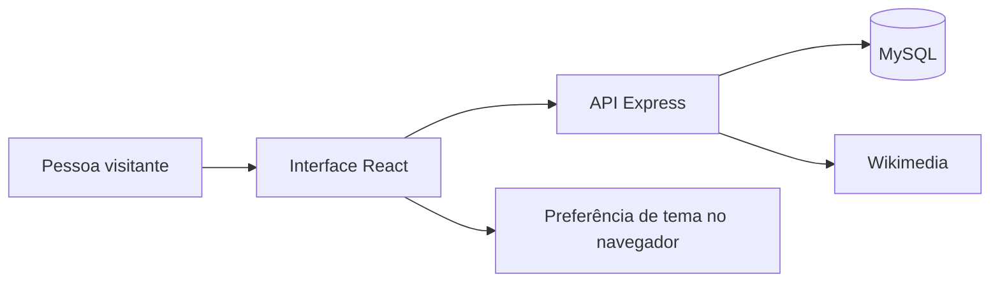

# HeroBoxd

<div align="center">
  
  <p><strong>Minha estante de histórias de heróis</strong></p>
  <p>Filmes, séries, jogos e HQs em um só lugar.</p>
</div>

## Sobre o projeto

Criei o HeroBoxd como um projeto de portfólio para explorar uma ideia que eu gosto: ter uma estante digital para descobrir histórias de super-heróis, registrar o que assisti ou li e compartilhar minhas opiniões. Ele reúne um catálogo demonstrativo com 80 títulos e permite pesquisar, filtrar, avaliar e organizar cada mídia.

Também quis construir o fluxo completo de uma aplicação, além da interface: cadastro e login, persistência no MySQL, avaliações públicas e uma área pessoal para listas. Este README apresenta o que implementei e mostra algumas telas reais do site.

## Uma visita pelas telas

### 1. Página inicial



Na abertura, apresento um título em destaque e levo a pessoa direto para o catálogo. A navegação também separa filmes, séries, jogos e HQs.

### 2. Catálogo e filtros



Organizei os títulos por formato. Dá para buscar pelo nome, filtrar por editora e escolher a ordem de exibição. Os cartões mostram o ano e a média das avaliações quando há opiniões publicadas.

### 3. Detalhes e avaliações da comunidade



Ao abrir um título, a pessoa encontra a sinopse, o ano e a avaliação média. Abaixo fica o espaço das resenhas: visitantes podem ler o que já foi publicado, e usuários conectados podem deixar a própria nota e opinião.

### 4. Cadastro



Para criar uma conta, peço nome, e-mail, idade e senha. Depois do cadastro, a pessoa já entra no site e pode avaliar as mídias.

## O que implementei

- Catálogo demonstrativo de 80 filmes, séries, jogos e HQs, com busca e filtros.
- Página de detalhes com sinopse, nota média e resenhas públicas.
- Cadastro e login; a senha é armazenada com derivação `scrypt`.
- Avaliações de uma a cinco estrelas e resenhas escritas.
- Estante pessoal com listas “Quero ver”, “Já vi/li” e “Favoritos”.
- Temas claro e escuro, layout responsivo e recursos básicos de PWA.
- Recuperação de senha por e-mail com token de uso único, quando o Resend está configurado.
- Exclusão de conta e dos dados associados.

## Como organizei a aplicação

| Parte | O que usei |
| --- | --- |
| Interface | React 18, HTML e CSS responsivo |
| Servidor e API | Node.js 24 LTS e Express 5 |
| Banco de dados | MySQL 8.4 ou superior |
| Sessões | Cookie `HttpOnly` e token de sessão armazenado como hash |
| Imagens | Miniaturas da Wikimedia, com indicação de origem e licença variável por imagem |
| Automação | GitHub Actions para verificações de sintaxe e testes de segurança |



Para conhecer as rotas e tabelas, consulte [docs/architecture.md](docs/architecture.md). Para detalhes de ambiente e publicação, consulte [docs/development-and-deployment.md](docs/development-and-deployment.md).

## Rodar no computador

Preparei o projeto para Node.js 24 LTS e MySQL 8.4+. Em um clone novo, na pasta do repositório, execute:

```powershell
npm ci
Copy-Item .env.example .env
```

Depois, edite o `.env` com os dados do seu MySQL. Crie as tabelas e o banco com o esquema incluído:

```powershell
mysql -u root -p
```

No prompt do MySQL, rode:

```sql
source backend/schema.sql
```

Por fim, volte ao terminal do projeto e inicie a aplicação:

```powershell
npm run seed
npm start
```

Abra o endereço indicado no terminal (por padrão, `http://127.0.0.1:4175`). O atalho `start-local.ps1` é específico da instalação original e depende de arquivos locais que não são enviados ao GitHub; em um clone novo, siga os passos acima. Se precisar, deixei mais detalhes em [instruções de desenvolvimento e publicação](docs/development-and-deployment.md).

## Avaliações e dados

As opiniões aparecem para quem acessa a mesma instalação do site e o mesmo banco de dados. No modo local, elas ficam no MySQL deste computador; por isso, não são automaticamente compartilhadas com outros visitantes ou dispositivos. Para isso, é necessário publicar a aplicação e conectá-la a um banco MySQL remoto persistente.

O nome escolhido aparece nas resenhas. A API pública não mostra e-mail nem idade. Também implementei exclusão de conta, que remove avaliações, listas e sessões ligadas à conta.

## Configuração para produção

O código inclui suporte a publicação em um host Node.js ou em contêiner. Para compartilhar o site de verdade, ainda é preciso configurar a hospedagem, um MySQL persistente e as variáveis do ambiente no painel do provedor. Não coloque o arquivo `.env`, dados do banco ou credenciais no GitHub.

Para enviar recuperação de senha por e-mail, configure `RESEND_API_KEY`, `MAIL_FROM` com remetente verificado e `PUBLIC_BASE_URL` com a URL HTTPS da aplicação. Sem essas credenciais, o fluxo de e-mail não envia mensagens. O arquivo [.env.example](.env.example) lista as variáveis necessárias.

Antes de abrir o cadastro ao público, também é preciso preencher os dados de contato na [política de privacidade](frontend/public/privacidade.html), configurar backups e conferir os direitos e atribuições das imagens e marcas usadas. A licença MIT cobre o código original deste projeto, não os conteúdos de terceiros.

## Verificações

Rodo as verificações locais com:

```powershell
npm run check
npm test
```

O mesmo fluxo é executado no GitHub Actions a cada alteração enviada ao repositório. O projeto inclui um `Dockerfile`, mas a imagem precisa ser construída no host ou em um ambiente com Docker disponível.

## Organização dos arquivos

```text
backend/               API, segurança, esquema e migrações do banco
frontend/public/        Página inicial, ícones, manifesto e política de privacidade
frontend/src/           Interface e estilos
docs/screenshots/       Capturas de tela mostradas neste README
docs/                   Arquitetura e instruções de desenvolvimento/publicação
```

## Licença e marcas

Disponibilizei o código original sob a licença MIT; consulte [LICENSE](LICENSE). Criei este projeto de forma independente, sem afiliação oficial com Marvel, DC ou outros detentores de marcas e personagens. A licença do código não concede direitos sobre marcas, personagens ou imagens de terceiros.
