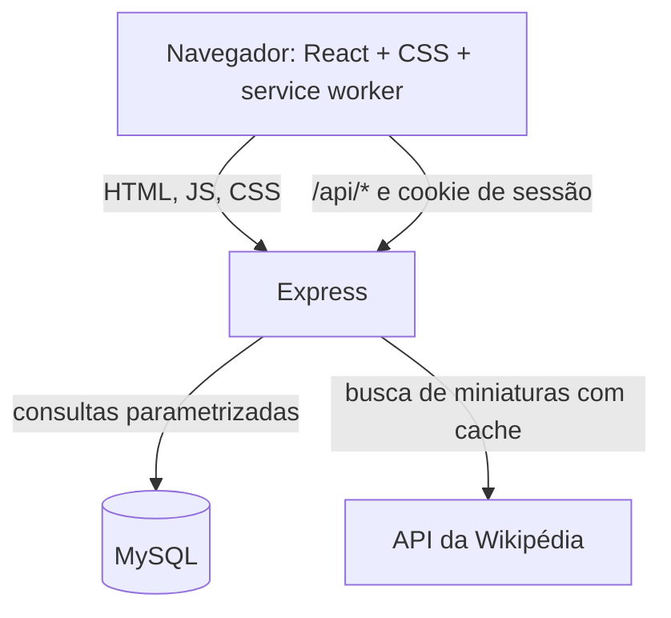
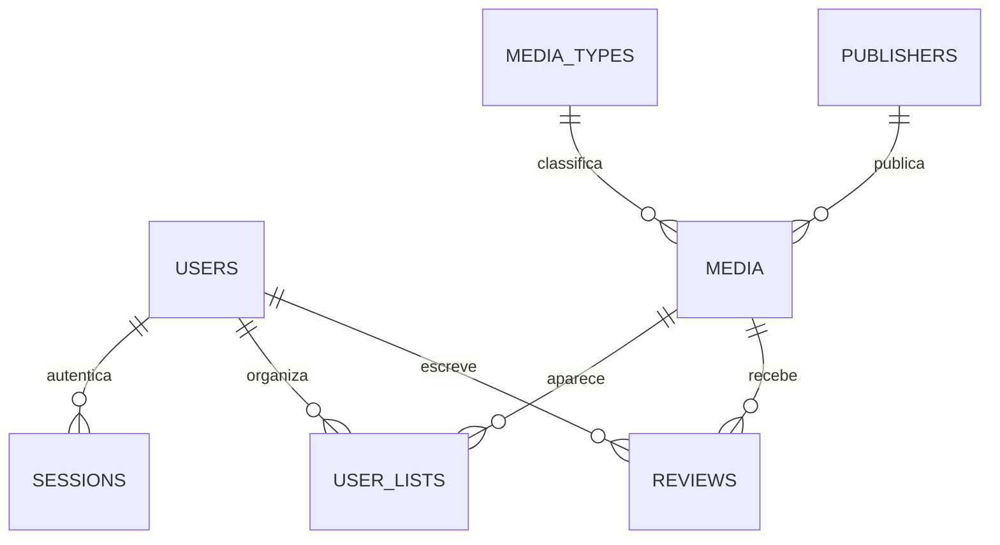

# Arquitetura

## Visão geral

O Express entrega a página, os arquivos estáticos, os builds UMD de React incluídos nas dependências e a API JSON. O navegador chama a mesma origem para manter sessão por cookie e evitar uma configuração CORS separada.

## Responsabilidades

### Frontend

- `frontend/public/`: documento inicial, marca, manifesto PWA, tema inicial e service worker.
- `frontend/src/app.js`: navegação do catálogo, cadastro/login, detalhes, avaliações e listas.
- `frontend/src/styles.css`, `cinema.css` e `cinema-fixes.css`: estilos visuais e responsivos.

### Backend

- `backend/server.js`: API Express, validação de entrada, autenticação, sessão e arquivos estáticos.
- `backend/schema.sql`: esquema para novos bancos.
- `backend/migrations/`: alterações incrementais para bancos já existentes.
- `backend/catalog.js`: sincroniza os 80 títulos demonstrativos e mantém registros antigos inativos.
- `backend/reset-local-password.js`: recuperação manual apenas para o banco MySQL local.

## Rotas principais

| Método e rota | Acesso | Uso |
| --- | --- | --- |
| `GET /api/media` | Público | Pesquisa, filtros, ordenação e paginação do catálogo |
| `GET /api/media/:id/reviews` | Público | Lista opiniões públicas para uma mídia |
| `POST /api/auth/register` | Público | Cria conta e inicia sessão |
| `POST /api/auth/login` | Público | Inicia sessão existente |
| `POST /api/reviews` | Sessão | Cria ou atualiza a nota/resenha da pessoa autenticada |
| `GET /api/users/me/lists` | Sessão | Carrega listas pessoais |
| `POST/DELETE /api/lists` | Sessão | Altera listas pessoais |

Operações de escrita validam a origem. A senha nunca é armazenada em texto aberto; o cookie contém um token aleatório e o banco guarda seu hash.

## Dados e visibilidade

Cada pessoa pode ter uma avaliação por mídia. As resenhas são públicas no mesmo deployment; as listas são privadas à conta autenticada. Nome aparece junto à opinião; e-mail e idade não são expostos nas rotas públicas.

O servidor local escuta em `127.0.0.1`, portanto outros computadores não acessam seu banco local. Para compartilhar opiniões com recrutadores ou visitantes em outros dispositivos, a aplicação publicada precisa usar o mesmo banco MySQL remoto persistente.

## Limites conhecidos

- As imagens dependem da Wikipédia/Wikimedia e de algumas URLs externas; o layout tem fallback sem imagem.
- Não há limite de tentativas de login, confirmação de e-mail, envio de recuperação de senha ou testes automatizados.
- Os arquivos React são servidos sem etapa de build; alterações de interface são publicadas diretamente com o servidor.
